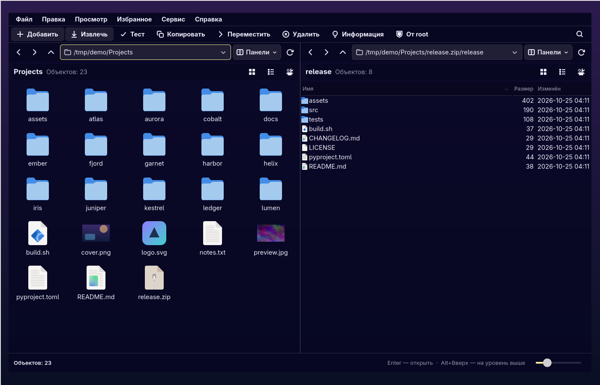

# Archive Navigator

**Двухпанельный файловый менеджер и архиватор для Linux** в духе «7-Zip File Manager» —
нативный GTK4 / Wayland, бэкенд — консольный `7z` / `7zz`.



Проект вырос из «7-Zip GTK»: интерфейс повторяет привычную логику файлового менеджера
7-Zip (две панели, дерево каталогов, список/плитки, диалоги добавления и распаковки),
но при этом это обычный файловый менеджер для повседневной работы.

## Возможности

### Файловый менеджер
- Одна или две панели (`F9`), у каждой своя история, путь и режим просмотра
- Подробный список с сортировкой по колонкам и плитки с миниатюрами (`Ctrl+1` / `Ctrl+2`)
- Масштаб значков (`Ctrl++` / `Ctrl+-`), фильтр по имени, быстрый переход по первым буквам
- Боковая панель: домашние каталоги, избранное, история переходов
- Выбор папки при запуске: домашняя или последняя открытая
- Съёмные диски и телефоны (MTP): подключение по клику, извлечение и автоматический выход из папки
- Сетевые подключения (SMB, SFTP, FTP, WebDAV, NFS, AFP) через GVfs: «Подключиться к серверу…», отключение и автоматический выход из папки
- Общий доступ к папке через Samba из свойств, как в Windows: имя ресурса, комментарий, права, гости и список пользователей
- Копирование, перемещение, переименование, создание папок и файлов
- Удаление в корзину или безвозвратно, отмена и повтор операций (`Ctrl+Z` / `Ctrl+Y`)
- Открыть в программе, открыть от root (через `pkexec`), свойства файла
- Значки `.desktop`-файлов и встроенные иконки Windows `.exe` (PE-ресурсы)
- Бейджи на значках: нет доступа, символическая ссылка

### Архивы
- Просмотр содержимого без распаковки, вход внутрь архива (`Ctrl+PgDn`)
- Создание архивов: 7z, zip, tar, gz, bz2, xz, lzma и другие форматы 7-Zip
- Уровень сжатия, пароль, solid-блоки, размер словаря, многотомные архивы
- Распаковка «сюда», в выбранную папку или с перемещением; выбор поведения при перезаписи
- Проверка архива, контрольные суммы, подробная информация
- Разделение файла на тома и объединение томов, конвертация между форматами
- Бенчмарк, как в 7-Zip

### Интерфейс
- Схемы `midnight`, `light`, `system`; дизайны `classic` и `nav`; плотность интерфейса
- Скрываемые строка меню и панель инструментов
- Русский и английский языки, переназначаемые горячие клавиши
- Прозрачность окна — через пользовательский CSS GTK4, без правок кода приложения
  (см. [Прозрачность](#прозрачность))

## Зависимости

| Дистрибутив | Пакеты |
|---|---|
| Arch Linux | `gtk4 python-gobject 7zip` |
| Debian / Ubuntu | `python3-gi gir1.2-gtk-4.0 7zip` |
| Fedora | `python3-gobject gtk4 p7zip p7zip-plugins` |

Нужен Python 3.10+ и установленный `7z` либо `7zz`. Сам архиватор 7-Zip в поставку
не входит — приложение только вызывает его команды.

Для телефонов и камер по MTP нужны `gvfs` и `gvfs-mtp` — в большинстве рабочих
окружений они уже установлены. Для сетевых подключений нужны `gvfs` и
соответствующий бэкенд: `gvfs-smb` для SMB, `gvfs-backends` (Debian/Ubuntu)
или `gvfs` (Arch) для SFTP/FTP/WebDAV.

Для общего доступа к папкам через Samba нужны `samba` (`smbd`, `testparm`)
и polkit (`pkexec`) для применения настроек от администратора:

| Дистрибутив | Пакеты |
|---|---|
| Arch Linux | `samba polkit` |
| Debian / Ubuntu | `samba policykit-1` |
| Fedora | `samba polkit` |

Если Samba не установлена, остальные возможности приложения работают как обычно,
а вкладка «Общий доступ» в свойствах папки сообщает об отсутствии пакетов.

## Общий доступ к папкам (Samba)

Откройте свойства локальной папки (`Alt+Enter`) и перейдите на вкладку
**«Общий доступ»**. Там можно включить ресурс и настроить его так же, как
в проводнике Windows:

- имя ресурса и комментарий;
- «Только чтение» или запись;
- гостевой доступ без пароля;
- список пользователей Samba, которым разрешён доступ;
- отображение в сетевом окружении.

Кнопка **«Применить»** сохраняет настройки, проверяет конфигурацию через
`testparm` и перезагружает Samba. Если служба не запущена, приложение
предложит её запустить. Изменения выполняются через `pkexec`, поэтому
появится системный запрос пароля администратора. Кнопка **«Отключить общий
доступ»** удаляет ресурс, не трогая саму папку.

Настройки хранятся отдельно от системного `smb.conf`, в файле
`/etc/samba/archive-navigator.conf`. При первом применении приложение
добавляет в конец секции `[global]` файла `smb.conf` одну строку:

```ini
# Archive Navigator: shared folders (managed include)
include = /etc/samba/archive-navigator.conf
```

Так системная конфигурация остаётся почти нетронутой, а все общие папки
приложения лежат в одном управляемом файле. При ошибке проверки
`testparm` оба файла автоматически возвращаются в исходное состояние.

Права Samba не отменяют права файловой системы: чтобы гости или другие
пользователи действительно получили доступ, проверьте права на вкладке
**«Права»**. Приложение предупреждает, если у папки нет нужных прав на
чтение или запись для остальных.

## Установка

```bash
git clone https://github.com/MemTim/archive-navigator.git
cd archive-navigator
./install.sh
```

Скрипт копирует файлы в `~/.local/share/sevenzip-gtk`, создаёт ссылку
`~/.local/bin/sevenzip-gtk` и пункт меню `~/.local/share/applications/io.sevenzipgtk.App.desktop`.

Удаление:

```bash
./install.sh --uninstall
```

Можно поставить в другие каталоги: `PREFIX=... BINDIR=... APPDIR=... ./install.sh`.

### Запуск без установки

```bash
python3 sevenzip-gtk.py
```

## Командная строка

```
sevenzip-gtk.py [папка | архив]
sevenzip-gtk.py --add файл...        # диалог «Добавить в архив»
sevenzip-gtk.py --extract архив...   # диалог «Распаковать»
sevenzip-gtk.py --extract-here архив...
```

## Горячие клавиши

Все сочетания меняются в **Настройки → Горячие клавиши**.

| Действие | Клавиши |
|---|---|
| Открыть архив | `Ctrl+O` |
| Войти в архив / выйти | `Ctrl+PgDn` / `Shift+Enter` |
| Просмотр / редактирование | `F3` / `F4` |
| Переименовать | `F2` |
| Копировать в… / переместить в… | `F5` / `F6` |
| Создать папку / файл | `F7` / `Ctrl+N` |
| Новое окно | `Shift+Ctrl+N` |
| Свойства | `Alt+Enter` |
| Добавить в архив / распаковать / тест | `Alt+A` / `Alt+E` / `Alt+T` |
| Поиск | `Ctrl+F` |
| Адресная строка | `Ctrl+L` |
| На уровень выше | `Alt+Up` / `Backspace` |
| Назад / вперёд | `Alt+Left` / `Alt+Right` |
| Две панели / переключить панель | `F9` / `Tab` |
| Список / плитки | `Ctrl+1` / `Ctrl+2` |
| Настройки | `Ctrl+,` |

## Прозрачность

Приложение не содержит правил прозрачности — они подключаются пользовательским CSS.
Создайте `~/.config/gtk-4.0/sevenzip-gtk.css`:

```css
window.sz-midnight {
    background-color: rgba(7, 7, 34, 0.85);
}

/* список и плитки — полностью прозрачные */
window.sz-midnight treeview.view,
window.sz-midnight gridview,
window.sz-midnight gridview.view {
    background-color: rgba(7, 7, 34, 0.0);
}

/* верхние панели — непрозрачные */
window.sz-midnight .sz-menubar,
window.sz-midnight .sz-toolbar,
window.sz-midnight .sz-panel > box:nth-child(1),
window.sz-midnight .sz-panel > box:nth-child(2) {
    background-color: rgba(7, 7, 34, 1.0);
}

/* выделенные строки */
window.sz-midnight treeview.view:selected,
window.sz-midnight gridview > child:selected {
    background-color: rgba(14, 14, 67, 1.0);
    color: #F3EDF7;
}
```

И импортируйте его в `~/.config/gtk-4.0/gtk.css`:

```css
@import url("sevenzip-gtk.css");
```

Правила действуют только для тёмной схемы `midnight`; в `light` и `system` окно
остаётся обычным. Для полупрозрачности нужен композитор (Mutter, KWin, picom и т. п.).

## Структура проекта

```
sevenzip-gtk.py          точка входа и разбор аргументов командной строки
szgtk/
  app.py                 Gtk.Application, открытие файлов из CLI
  window.py              главное окно, меню, действия, горячие клавиши
  panel.py               панель: список, плитки, миниатюры, операции
  sidebar.py             боковая панель с местами и избранным
  menu.py                выпадающие меню, рисуемые внутри окна
  backend.py             вызовы 7z/7zz, задания и прогресс
  archive_dialogs.py     диалоги добавления, распаковки, разделения
  convert.py             конвертация архивов
  benchmark.py           бенчмарк
  properties.py          свойства файлов и архивов
  samba.py               общие папки Samba: конфиг, проверка, служба
  settings.py            настройки и редактор горячих клавиш
  dialogs.py             базовые диалоги и виджеты
  theme.py               CSS-темы приложения
  icons.py               значки, бейджи, кэш
  fileicons.py           иконки .desktop и Windows .exe
  vfs.py                 виртуальная файловая система (архивы)
  utils.py, display.py, favorites.py, ops.py, menu_layout.py
  i18n.py                русский и английский
data/                    .desktop-файл и значки приложения для меню
install.sh               установка / удаление
```

## Значки

В репозитории нет чужих иконок: приложение запрашивает стандартные имена значков
(`folder`, `text-x-generic`, `package-x-generic` и т. п.) из системной темы
оформления — GTK сам подставляет подходящий значок из темы пользователя.
Собственные ресурсы проекта — только три простых SVG-бейджа в `szgtk/assets`
(замок, ссылка, крестик) и значок приложения в `data/icons`.

## Лицензия

[PolyForm Noncommercial 1.0.0](LICENSE) — код можно использовать, изменять и
распространять в любых **некоммерческих** целях. Коммерческое использование не разрешено.
